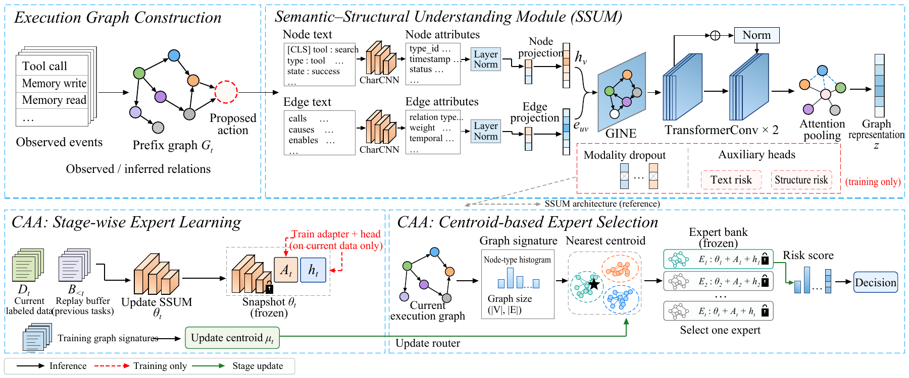

# GRAD

**Graph-Structured Antibody Defense for LLM Agents**

*Connect execution evidence. Acquire and reuse detection experts.*

Execution-graph attack detection and continual adaptation for LLM agents.

[](https://arxiv.org/abs/2610.22828) [](#quick-start) [](LICENSE)

**Tianqi Song (1) · Jiawei Du (2) · Xuemei Jia (1) · Zheng Wang (1)**

(1) Wuhan University  
(2) Agency for Science, Technology and Research (A*STAR)

[Paper](https://arxiv.org/abs/2610.22828) · [Overview](#from-agent-operations-to-attack-evidence) · [Results](#reported-results) · [Quick start](#quick-start) · [Citation](#citation)



*SSUM aggregates operation evidence; CAA acquires and reuses task-specific detection experts.*

[Back to top](#grad)

## News

| Date | Update |
| --- | --- |
| 2026-10-19 | Prepared the repository snapshot for private review, with offline reproduction commands and maintenance documentation. Public release awaits maintainer approval. |
| 2026-10-16 | [GRAD v1](https://arxiv.org/abs/2610.22828v1) is available on arXiv. |

[Back to top](#grad)

## From Agent Operations to Attack Evidence

Memory poisoning and decomposition attacks can distribute malicious evidence across an agent's operations. A detector must connect earlier information to later actions, then adapt as task contexts change.

> **How can a detector connect evidence across operations while acquiring and retaining detection capabilities across tasks?**

GRAD combines two modules:

- **Semantic–Structural Understanding Module (SSUM).** Encodes operation text, event attributes and typed candidate relations in an execution graph to produce a graph-level risk score.
- **Continual Antibody Adaptation (CAA).** Adds detection experts on updated encoder snapshots and selects experts through centroid routing as tasks arrive.

A local pre-execution gate supports blocking and replanning in the evaluated agent environments. The [paper](https://arxiv.org/abs/2610.22828) defines the detection, continual-learning and closed-loop protocols.

**Contents**

- [Reported results](#reported-results)
- [Quick start](#quick-start)
- [Training and evaluation](#training-and-evaluation)
- [Repository guide](#repository-guide)
- [Release status](#release-status)
- [Citation](#citation)
- [Contributing and contact](#contributing-and-contact)
- [License](#license)

---

[Back to top](#grad)

## Reported Results

| Evaluation | GRAD result | Protocol |
| --- | --- | --- |
| Static Decomp / MCP / MRT | **97.19 / 77.59 / 86.60** AUROC (%) | Main static evaluation |
| Cross-dataset continual stream | **77.86%** accuracy; **+13.08** percentage points over Replay | Snapshot experts; equal-family/base-case gain **+9.05** points |
| Matched decision-time Decomp | **97.00%** mean AUROC | W1; Temporal 91.69%, Text-only 86.36% |

Static and matched decision-time results use different observation protocols. Cross-dataset and family-isolated continual-learning results are reported separately. See the [reproduction guide](docs/REPRODUCIBILITY.md) and paper for protocol definitions, family-isolated outcomes and negative controls.

[Back to top](#grad)

## Quick Start

Use Python 3.11 or 3.12. Run the following commands from the repository root.

### Recompute the closed-loop table

No GPU, model download or API key is required:

```bash
python scripts/verify_release.py
python scripts/reproduce.py --task t3
```

This uses the original aggregation implementation to check **240 recorded outcomes**, all six backbone/defense cells, paired comparisons and per-family counts against the archived results. Outputs are written under `outputs/t3/`.

### Check matched decision-time detection

```bash
python -m venv .venv
source .venv/bin/activate
python -m pip install -r requirements-analysis.txt
python scripts/reproduce.py --task w1
python -m unittest discover -s tests -v
```

The W1 command checks nine runs on 232 examples, including AUROC and development-frozen operating points. Expected mean AUROCs:

| GRAD | Text-only | Temporal |
| --- | --- | --- |
| `0.9699597041` | `0.8635552913` | `0.9169474171` |

These commands reanalyze saved outcomes and scores. They do not retrain models, rerun online agents or regenerate W1 bootstrap confidence intervals. See [validation records](docs/VALIDATION.md) for the checks and environment actually tested.

[Back to top](#grad)

## Training and Evaluation

Install `requirements-models.txt` with a PyTorch wheel appropriate for your hardware. Recorded GPU experiments used PyTorch 2.2.2+cu121; the dependency files specify package ranges rather than an exact training environment lock.

| Start here | What it covers |
| --- | --- |
| [Reproduction guide](docs/REPRODUCIBILITY.md) | W1 seed-211 training configuration, CAA entry points and optional online dependencies |
| [Paper-to-code map](docs/PAPER_TO_CODE.md) | Implementations and evidence for each experiment |
| [Data guide](data/README.md) | Required inputs, provenance and distribution status |
| [Checkpoint guide](checkpoints/README.md) | Model artifacts and release requirements |

Training data and weights are not included in this checkout. Complete CAA retraining requires additional stream inputs and expert artifacts described in the guides.

[Back to top](#grad)

## Repository Guide

```text
assets/                   Method overview
code/run.py               Portable launcher for original research scripts
code/project/code/        Frozen SSUM, CAA, baselines and experiment implementations
evidence/                 Numeric outcomes, labels, scores and reference statistics
scripts/                  Public release checks and offline reproduction entry points
docs/                     Protocols, paper mapping, provenance and release process
tests/                    Offline release regression checks
.github/                  CI, issue and pull request templates
```

The research layout preserves internal imports. The [paper-to-code map](docs/PAPER_TO_CODE.md) identifies reported configurations and historical candidates. Unvalidated October 15 MCP iterations are outside this paper snapshot.

[Back to top](#grad)

## Release Status

This snapshot accompanies [arXiv:2610.22828v1](https://arxiv.org/abs/2610.22828v1) and is prepared for private maintainer review. GitHub remote setup is pending an authenticated connection. Public visibility requires explicit maintainer approval; no public release or paper tag has been created.

- **Included:** original research source, numeric T3 outcomes, W1 labels and scores, frozen thresholds, reference statistics and offline checks.
- **Not included:** raw benchmark text, converted training graphs, full execution traces, model weights and complete CAA expert pools. Their public distribution has not been finalized; there is no public artifact download link yet.
- **Before publication:** complete third-party source attribution and permission review, select the repository destination and decide data/weight distribution.
- **CI:** offline checks are configured for Python 3.11 and 3.12. GitHub-hosted CI has not run yet; local checks are documented in [VALIDATION.md](docs/VALIDATION.md).

The [maintenance policy](docs/MAINTENANCE.md) describes fixed paper-version tags and subsequent software releases.

[Back to top](#grad)

## Citation

If you use GRAD in your research, please cite:

```bibtex
@misc{song2026grad,
  title={GRAD: Graph-Structured Antibody Defense for LLM Agents},
  author={Tianqi Song and Jiawei Du and Xuemei Jia and Zheng Wang},
  year={2026},
  eprint={2610.22828},
  archivePrefix={arXiv},
  primaryClass={cs.CR},
  url={https://arxiv.org/abs/2610.22828}
}
```

Machine-readable citation metadata is available in [CITATION.cff](CITATION.cff).

[Back to top](#grad)

## Contributing and Contact

Reproduction questions, corrections and focused improvements are welcome. Open an issue with the paper version, code commit, environment and command, or submit a pull request following the [contribution guide](CONTRIBUTING.md).

Contact: [2024302111167@whu.edu.cn](mailto:2024302111167@whu.edu.cn).

[Back to top](#grad)

## License

Original GRAD software and documentation are available under the [MIT License](LICENSE). Third-party code and data retain their applicable terms; see [THIRD_PARTY_NOTICES.md](THIRD_PARTY_NOTICES.md). The software license and the paper's arXiv license are separate.
